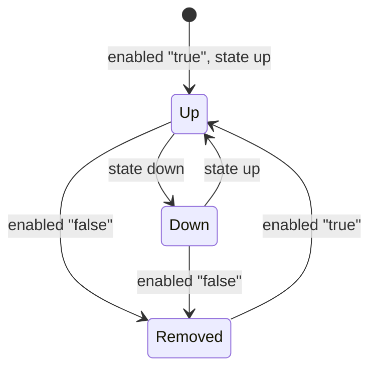

# Environment lifecycle

Each environment is controlled by three keys in `environments/<env>/env.yaml`:

| Key | Values | Effect |
|---|---|---|
| `enabled` | `"true"` / `"false"` (quoted) | `"true"`: Argo CD deploys the env. `"false"`: the ApplicationSet deletes the env's Application and Argo CD deletes everything it deployed. |
| `state` | `up` / `down` | `down`: workloads scaled to **0 replicas**; the env stays installed so it comes back fast. `up`: configured replicas. |
| `targetRevision` | git branch / tag / SHA | where the env's specs are deployed from |

Changes take effect when they land on `main` (Argo CD polls git every ~3 min by
default; `scripts/envctl.sh sync <env>` forces a refresh).

## States



| State | What runs | Resources used | Time to get back to Up |
|---|---|---|---|
| **Up** | everything | full | — |
| **Down** | operators / daemonsets / namespaces; workloads at 0 | small | seconds to a minute |
| **Removed** | nothing from this env | none (see leftovers below) | full install, minutes |

What "down" means per environment is in that environment's README.

## With envctl

```bash
scripts/envctl.sh list                       # all envs and switches
scripts/envctl.sh up <env> [--push]          # deploy or scale up
scripts/envctl.sh down <env> [--push]        # scale to 0
scripts/envctl.sh remove <env> [--push]      # uninstall
scripts/envctl.sh status <env>               # Applications + pods
scripts/envctl.sh sync <env>                 # refresh + sync now
scripts/envctl.sh purge <env> [--crds]       # clean leftovers after remove
```

`up/down/remove` edit `env.yaml` and commit. Add `--push` to push, or
`--no-commit` to only edit (e.g. to bundle with other changes in a PR).

## By hand

Edit `env.yaml`, commit, push to `main`. That is all `envctl` does.

## Without git (emergency only)

Pausing outside git is possible but will be reverted by self-heal/the
ApplicationSet unless you disable automation first:

```bash
# stop Argo CD from reverting, then scale things by hand
kubectl -n argocd patch application testenv-<env> --type merge \
  -p '{"spec":{"syncPolicy":{"automated":null}}}'
```

The ApplicationSet will restore the automated policy on its next reconcile, so
follow up with a git change.

## Leftovers after removal

Argo CD deletes what it applied. It does not delete things created at runtime
by operators, e.g. CRDs the Dynamo operator installs itself, or node labels.
`scripts/envctl.sh purge <env>` removes leftover env-labelled namespaces and
stuck finalizers; `--crds` also deletes the env's CRDs. Environment READMEs list
their specific leftovers.
