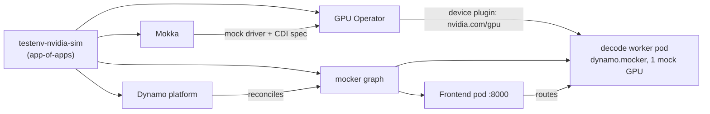

# nvidia-sim

A simulated NVIDIA GPU inference stack on a **CPU-only, single-node k3s**
cluster. It follows NVIDIA's
[Simulate a Kubernetes Deployment with Mocker](https://docs.nvidia.com/dynamo/knowledge-base/concepts/simulation/kubernetes-mocker)
guide, with [Mokka](https://github.com/NVIDIA/k8s-test-infra) providing mock
GPUs so the real GPU Operator and the Dynamo worker's `nvidia.com/gpu` request
behave as on a GPU node (as in Mokka's
[Dynamo guide](https://github.com/NVIDIA/k8s-test-infra/blob/v0.6.0/docs/guides/dynamo/README.md)).

Use it to test control-plane behaviour — scheduling, routing, the
OpenAI-compatible API, Dynamo operator/DGD handling, GPU monitoring and
alerting — **not** performance. Responses are random tokens by design.

## Components

| Order | Component | Chart / version | Namespace | Argo CD Application |
|---|---|---|---|---|
| 0 | **Mokka** (nvml-mock): mock NVML, `nvidia-smi`, CDI spec, NRI plugin; profile `h100` | `oci://ghcr.io/nvidia/k8s-test-infra/chart/nvml-mock` `0.6.0` | `nvidia-sim-mokka` | `nvidia-sim-mokka` |
| 1 | **NVIDIA GPU Operator**: device plugin, GFD, dcgm-exporter, validator (driver/toolkit off) | `nvidia/gpu-operator` `v26.3.3` | `nvidia-sim-gpu-operator` | `nvidia-sim-gpu-operator` |
| 2 | **NVIDIA Dynamo platform**: operator only (no etcd/NATS/Grove/KAI) | `ai-dynamo/dynamo-platform` `1.6.1` | `nvidia-sim-dynamo-system` | `nvidia-sim-dynamo-platform` |
| 3 | **Mocker graph**: `DynamoGraphDeployment` `mocker-agg` — Frontend + `decode` worker running `python3 -m dynamo.mocker` (`Qwen/Qwen3-0.6B`), worker requests 1 mock GPU | [graph/](graph/) | `nvidia-sim` | `nvidia-sim-graph` |
| 4 | **Simulation controller** (optional, `components.simulator`, off by default): inject GPU/Dynamo/Kubernetes faults during tests | [simulations/controller](../../simulations/controller/README.md) | `sim-system` | `nvidia-sim-simulator` |



Versions are pinned on purpose: GPU Operator must stay on v26.3.x (v26.7.x
gates operands on `/proc/modules`, which Mokka can't serve). Bump versions in
[values.yaml](values.yaml).

Images pulled: `ghcr.io/nvidia/nvml-mock`, GPU Operator images from `nvcr.io`,
and `nvcr.io/nvidia/ai-dynamo/dynamo-planner:1.6.1` (large, several GB — first
start is slow). The mocker fetches the model's config/tokenizer (not weights)
from Hugging Face, so the node needs internet access.

## Prerequisites

1. **k3s v1.31+** recommended (containerd 2.x: NRI and CDI on by default).
   Node needs ~4 CPU / 8 GiB free.
2. **One-time host prep on the k3s node** — required on k3s:

   ```bash
   sudo environments/nvidia-sim/scripts/k3s-host-prep.sh          # do it
   sudo environments/nvidia-sim/scripts/k3s-host-prep.sh --check  # just report
   ```

   Why: Mokka normally configures containerd itself, but k3s embeds its own
   containerd, which Mokka deliberately leaves alone (so the chart sets
   `nodeAgent.containerRuntime.enabled: false`). The script instead installs
   the NVIDIA Container Toolkit binaries (no driver), sets the runtime to CDI
   mode, ensures NRI is on in k3s containerd, restarts k3s so it registers the
   `nvidia` runtime handler, and ensures the `nvidia` RuntimeClass exists.
   Restarting k3s briefly takes the API server down.
3. Argo CD bootstrapped from [argocd/](../../argocd/) (see the root README),
   ideally with the Application health patch so components start in order.

Only **one Mokka release per cluster**: its host paths are fixed.

## Lifecycle

| | What runs | Notes |
|---|---|---|
| `state: up` | everything | |
| `state: down` | Mokka, GPU Operator, Dynamo operator; **graph at 0 replicas** (frontend + worker pods gone, DGD kept) | Fast to resume: images are cached and the platform stays ready. |
| `enabled: "false"` | nothing | all four Applications and their resources deleted |

```bash
scripts/envctl.sh down nvidia-sim --push
scripts/envctl.sh up nvidia-sim --push
scripts/envctl.sh remove nvidia-sim --push
```

### Removing single components

Each component has `enabled` in [values.yaml](values.yaml) under `components:`.
E.g. to free the GPU Operator's daemonsets while keeping the rest, set
`components.gpuOperator.enabled: false` (the worker then can't get a GPU unless
you also set `components.graph.values.decode.gpus: 0`, which runs the mocker
without GPU scheduling, like the upstream Dynamo example).

### Removing cleanly

For the tidiest teardown, scale down first so the Dynamo operator deletes the
graph's pods while it still exists, then remove:

```bash
scripts/envctl.sh down nvidia-sim --push     # wait for frontend/worker pods to go
scripts/envctl.sh remove nvidia-sim --push
scripts/envctl.sh purge nvidia-sim           # finalizers, leftover namespaces
scripts/envctl.sh purge nvidia-sim --crds    # ...and the CRDs, for a clean slate
```

**Leftovers Argo CD does not track:** Dynamo CRDs (installed at runtime by the
operator), GPU Operator / NFD CRDs (Argo CD keeps CRDs by default), NFD node
labels (cleaned by NFD's post-delete job), the toolkit installed by host prep,
and Mokka's host directories (`/var/lib/nvml-mock`; Mokka reverts its CDI spec
when its pod stops). Undo host prep's containerd change with
`k3s-host-prep.sh --undo`.

## Failure and recovery simulations

[simulations/nvidia-sim](../../simulations/nvidia-sim/README.md) covers this
environment ([full catalog](../../simulations/controller/CATALOG.md)):
GPU Xid, lost GPU, ECC, overheating, throttling, memory pressure, NVLink and
fabric faults through Mokka; Dynamo worker/frontend kills and partitions; and
the [generic faults](../../simulations/faults/README.md) (latency, jitter,
loss, outages, stress). Every simulation can be measured against a baseline
with the [observability environment](../observability/README.md). Enable `components.simulator` (after publishing the
image and creating its token Secret) to run them through Argo CD.

## Running alongside runai-sim

[runai-sim](../runai-sim/README.md) (KAI Scheduler + Run:ai fake-gpu-operator
on KWOK virtual nodes) can share the cluster. Mokka here has a
`type NotIn [kwok]` node affinity so it stays off the virtual nodes. To have
the Dynamo graph scheduled by KAI, set `global.kai-scheduler.enabled: true` in
`components.dynamoPlatform.values` (commented in [values.yaml](values.yaml)).

## Configuration

Everything is in [values.yaml](values.yaml) (`components.<name>.values` is
passed straight to the upstream chart) and [graph/values.yaml](graph/values.yaml):

| Want to… | Set |
|---|---|
| different mock GPU | `components.mokka.values.gpu.profile` (`a100`, `h100`, `b200`, `gb200`, `gb300`, `l40s`, `t4`) |
| more workers | `components.graph.values.decode.replicas` (≤ mock GPU count, 8 on h100) |
| faster-than-real-time simulation | `components.graph.values.decode.speedupRatio` |
| extra mocker flags | `components.graph.values.decode.extraArgs` ([Mocker CLI reference](https://docs.nvidia.com/dynamo/reference/components/mocker-cli-reference)) |
| a gated model | create a Secret with `HF_TOKEN` in `nvidia-sim`, set `components.graph.values.hfTokenSecret` |
| run without mock GPUs | `components.graph.values.decode.gpus: 0` (and disable Mokka / GPU Operator if you like) |

## Verify

```bash
scripts/envctl.sh status nvidia-sim

# mock GPUs advertised by the real device plugin
kubectl get node -o jsonpath='{.items[0].status.allocatable.nvidia\.com/gpu}'; echo
kubectl get node -o jsonpath='{.items[0].metadata.labels.nvidia\.com/gpu\.product}'; echo

# graph ready
kubectl -n nvidia-sim get dgd mocker-agg
kubectl -n nvidia-sim wait --for=condition=Ready pod \
  -l nvidia.com/dynamo-graph-deployment-name=mocker-agg --timeout=600s

# the worker sees the node's mock GPU
WORKER=$(kubectl -n nvidia-sim get pod \
  -l nvidia.com/dynamo-graph-deployment-name=mocker-agg,nvidia.com/dynamo-component-type=decode \
  -o jsonpath='{.items[0].metadata.name}')
kubectl -n nvidia-sim exec "$WORKER" -- nvidia-smi -L

# a request through frontend -> router -> mocker
kubectl -n nvidia-sim port-forward svc/mocker-agg-frontend 8000:8000 &
curl -s localhost:8000/v1/models
curl -s localhost:8000/v1/chat/completions -H 'Content-Type: application/json' \
  -d '{"model":"Qwen/Qwen3-0.6B","messages":[{"role":"user","content":"Hello!"}],"max_tokens":16}' \
  | jq '{content: .choices[0].message.content, usage}'
```

Success = `usage.completion_tokens` equals `max_tokens` (the content is noise).

## Troubleshooting

| Symptom | Cause / fix |
|---|---|
| Node advertises 0 `nvidia.com/gpu`, device plugin crash-loops | Host prep not done, or k3s not restarted after it: `sudo k3s-host-prep.sh --check`. Also check `helm get values` shows `driver.enabled=false`, `toolkit.enabled=false` in the GPU Operator app. |
| GPU Operator pods fail with `no runtime for "nvidia"` | k3s didn't register the handler: re-run host prep (it restarts k3s). |
| `nvml-mock` pod not Ready, `nvml-mock-nri` crash-loops | NRI is off in k3s containerd: `--check` reports the socket. Re-run host prep, or set `components.mokka.values.nri.enabled: false` (the worker then reports a default A100 identity). |
| Worker reports `Mock NVIDIA A100-SXM4-40GB` | NRI not registered when the worker started; delete the worker pod. |
| Worker `Pending` | No GPUs advertised yet (see first row) or more `decode.replicas` than mock GPUs. |
| `nvidia-sim-graph` app: `no matches for kind DynamoGraphDeployment` | Dynamo operator hasn't installed its CRDs yet; the app retries automatically. |
| `/v1/models` empty for > 2 min | Frontend missed the worker on a cold start: delete the frontend pod. |
| `nvidia-sim-dynamo-platform` OutOfSync on webhooks | Should be ignored (`caBundle` is injected at runtime and listed in `ignoreDifferences`); hard-refresh the app. |
| Removal stuck, namespace `Terminating` | DGD finalizer with the operator already gone: `scripts/envctl.sh purge nvidia-sim`. |

## Files

```text
env.yaml                    lifecycle switches (enabled / state / revision)
Chart.yaml, values.yaml     app-of-apps: one child Application per component
templates/                  child Application templates
graph/                      chart for the DynamoGraphDeployment
scripts/k3s-host-prep.sh    one-time node preparation for k3s
scripts/purge-extra.sh      used by envctl purge: finalizers, CRDs
```
