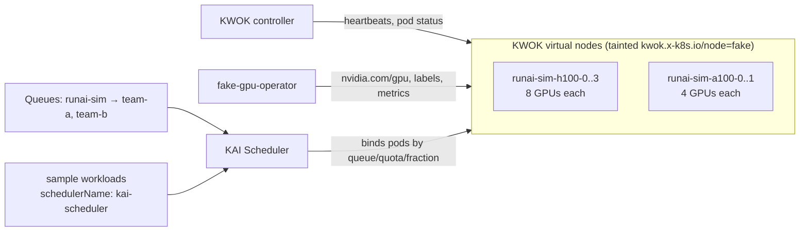

# runai-sim

Run:ai-style GPU cluster scheduling on **non-GPU hardware**: a fleet of
**virtual GPU nodes** (KWOK + Run:ai's fake-gpu-operator), scheduled by
**KAI Scheduler**, the open-source scheduler that Run:ai's scheduling is built on.
You get Run:ai's scheduling model (projects/departments as queues,
guaranteed quota, over-quota fair share, preemption by priority, gang
scheduling, fractional GPUs, binpacking) across dozens of "GPUs" on a
single-node k3s box.

Use it to test scheduling behaviour, quotas, fairness, GPU sharing, queue
dashboards, admission/policy tooling and failure handling. It's not for
running GPU code: pods on virtual nodes are marked Running by KWOK, and
nothing executes.

> **Not the Run:ai product.** The Run:ai control plane (UI, projects API,
> workload CRDs) is commercial and needs a tenant and license. It isn't
> included. KAI Scheduler is the open-source core, and fake-gpu-operator is
> the tool Run:ai itself uses to simulate GPUs. Install the Run:ai cluster
> components on top if you have a license (see "With a Run:ai control plane").

## Why a separate environment (not part of nvidia-sim)

fake-gpu-operator requires a node **without** the NVIDIA GPU Operator, while
nvidia-sim runs the real GPU Operator on the Mokka node. Running FGO's real-node
components there would double-register `nvidia.com/gpu`. So runai-sim puts FGO's
GPUs only on KWOK virtual nodes, which can share the cluster with
nvidia-sim. With both enabled you get the "mixed cluster" Mokka recommends: one
node with full driver fidelity (Mokka) plus a cheap virtual fleet (FGO).

## Components

| Order | Component | Chart / version | Namespace | Argo CD Application |
|---|---|---|---|---|
| 0 | **KWOK** controller: simulates kubelets for nodes annotated `kwok.x-k8s.io/node=fake` | `kwok/kwok` `0.3.0` (kwok v0.8.0) | `runai-sim-kwok` | `runai-sim-kwok` |
| 1 | **KWOK stages** (`stage-fast`): nodes Ready, pods Running/Completed immediately | `kwok/stage-fast` `0.3.0` | `runai-sim-kwok` | `runai-sim-kwok-stages` |
| 1 | **Virtual GPU nodes**: 4× `h100` pool (8 GPUs each), 2× `a100` pool (4 each) = **40 GPUs** | [nodes/](nodes/) | cluster-scoped | `runai-sim-nodes` |
| 2 | **Run:ai fake-gpu-operator**: GPU capacity and `nvidia.com/gpu.*` labels on the virtual nodes, fake DCGM metrics, GPU index reporting for fractions | `oci://ghcr.io/run-ai/fake-gpu-operator` `0.2.1` | `runai-sim-fgo` | `runai-sim-fake-gpu-operator` |
| 2 | **KAI Scheduler** with GPU sharing on (v0.17.0, the version Dynamo 1.6.1 integrates with) | `oci://ghcr.io/kai-scheduler/kai-scheduler` `v0.17.0` | `kai-scheduler` | `runai-sim-kai-scheduler` |
| 3 | **Queues + sample workloads** | [workloads/](workloads/) | `runai-sim` | `runai-sim-workloads` |
| 4 | Simulation controller (optional, off) | [simulations/controller](../../simulations/controller/README.md) | `sim-system` | `runai-sim-simulator` |



### Queues and workloads

| Queue | Parent | GPU quota | Limit | Over-quota weight |
|---|---|---|---|---|
| `runai-sim` (department) | — | 24 | none | 1 |
| `team-a` (project) | runai-sim | 16 | none | 2 |
| `team-b` (project) | runai-sim | 8 | 24 | 1 |

| Workload | Queue | Shape | Shows |
|---|---|---|---|
| `train-whole-gpu` | team-a | Deployment 4 × 2 GPUs, priority `train` | whole-GPU allocation, binpack |
| `notebook-half-gpu` | team-b | Deployment 4 × `gpu-fraction: 0.5`, priority `build` | **GPU sharing**: 2 pods per GPU |
| `distributed-job` | team-a | Job 4 pods × 4 GPUs | **gang scheduling**: all 4 or none |
| `inference` | team-b | Deployment 2 × 1 GPU, priority `inference` | high-priority preemption |

Edit `components.workloads.values` / [workloads/values.yaml](workloads/values.yaml)
to change queues and workloads, and `components.nodes.values.pools` plus
`components.fakeGpuOperator.values.topology.nodePools` to resize the fleet
(pool names must match in both). A workload is any pod with
`schedulerName: kai-scheduler`, the label `kai.scheduler/queue: <queue>`, the
`kwok.x-k8s.io/node` toleration and `nodeSelector: {type: kwok}`.

## Prerequisites

- Any Kubernetes ≥ 1.28 (single-node k3s is fine). No host preparation, GPU
  toolkit or privileged node setup is needed.
- Argo CD bootstrapped from [argocd/](../../argocd/) (this adds the KWOK,
  FGO and KAI chart repos to the project).
- About 1.5 CPU / 2 GiB for the controllers. The virtual nodes cost almost nothing.

## Lifecycle

The env starts **disabled** (`enabled: "false"` in [env.yaml](env.yaml)).

| | What runs | Notes |
|---|---|---|
| `scripts/envctl.sh up runai-sim --push` | everything | |
| `state: down` | KWOK, nodes, FGO, KAI, queues; sample Deployments at 0, Job suspended | your own workloads keep running |
| `scripts/envctl.sh remove runai-sim --push` | nothing | virtual Node objects are deleted too |

Leftovers after removal: the KAI CRDs (`scheduling.run.ai`, `kai.scheduler`)
and KWOK CRDs (Argo CD keeps CRDs), and namespace `kai-resource-reservation`.
`scripts/envctl.sh purge runai-sim` deletes the leftover env-labelled
namespaces.

## Verify

```bash
scripts/envctl.sh status runai-sim

kubectl get nodes -l type=kwok -L run.ai/simulated-gpu-node-pool,nvidia.com/gpu.product
kubectl get nodes -l type=kwok -o custom-columns=NODE:.metadata.name,GPUS:.status.allocatable.nvidia\.com/gpu
kubectl get queues                                   # KAI queues
kubectl -n runai-sim get pods -o wide                # all on runai-sim-* virtual nodes
kubectl -n runai-sim get podgroups                   # KAI pod groups (gang)
kubectl -n runai-sim get pods -l app=notebook-half-gpu \
  -o custom-columns=POD:.metadata.name,NODE:.spec.nodeName,GPU-GROUP:.metadata.labels.runai-gpu-group
```

Expected: 6 Ready virtual nodes with 8/8/8/8/4/4 GPUs; all sample pods
Running; the four `notebook-half-gpu` pods share two GPUs (pairs with the same
GPU group); the Job's four pods start together.

Try the scheduling behaviour:

```bash
# Over quota: team-b borrows idle GPUs, then is preempted when team-a needs them
kubectl -n runai-sim scale deploy/notebook-half-gpu --replicas=40
kubectl -n runai-sim scale deploy/train-whole-gpu --replicas=10
kubectl get queues -o custom-columns=QUEUE:.metadata.name,ALLOCATED:.status.allocated.gpu
```

(Argo CD self-heal resets those replica counts. Set them in git for a lasting
change, or use your own Deployments in another namespace.)

## Failure and recovery simulations

See [simulations/runai-sim](../../simulations/runai-sim/README.md):
`kwok-node-down` (a virtual GPU node fails → NotReady → evictions →
rescheduling by KAI), `fgo-gpu-utilization` (idle or saturated GPUs in the
metrics), plus `pod-kill`, `network-isolate` and `node-cordon`. Enable
`components.simulator` here **or** in nvidia-sim (one per cluster).

## Running alongside nvidia-sim

Both can be enabled on the same cluster:

- The virtual nodes are tainted, so nvidia-sim's pods and the GPU Operator's
  operands stay off them. nvidia-sim's Mokka DaemonSet tolerates every taint,
  so nvidia-sim sets a `type NotIn [kwok]` affinity on it.
- FGO's RuntimeClass (`nvidia`, handler `runc`) and CRDs (`ClusterPolicy`,
  `ComputeDomain`) are disabled here, so nvidia-sim's real `nvidia` handler
  and GPU Operator CRD are left alone. KAI is told not to force a RuntimeClass
  on fractional pods.
- FGO's real-node fake device plugin is off. Its fake dcgm-exporter DaemonSet
  has a hard-coded `nvidia.com/gpu.deploy.dcgm-exporter=true` node selector, so
  it also starts on the Mokka node, where it has no pool to report. If it
  misbehaves there, set `components.fakeGpuOperator.values.statusExporter.enabled: false`
  (this drops FGO's fake metrics, including for virtual nodes).
- KAI sees the Mokka node's 8 mock GPUs too. To have **Dynamo** scheduled by KAI,
  set `global.kai-scheduler.enabled: true` in nvidia-sim's
  `components.dynamoPlatform.values` (see the comment there).

## With a Run:ai control plane

If you have a Run:ai tenant: install the Run:ai cluster components per Run:ai's
docs (they bring their own scheduler, so disable `components.kaiScheduler`)
and set `components.fakeGpuOperator.values.statusUpdater.runaiIntegration.enabled: true`
plus FGO's `environment.resourceReservationNamespace: runai-reservation`. That
setup isn't tested here.

## Troubleshooting

| Symptom | Fix |
|---|---|
| Virtual nodes `NotReady` | KWOK not running, or stages missing: `kubectl -n runai-sim-kwok get pods`, `kubectl get stages`. |
| Nodes have no `nvidia.com/gpu` | FGO pool names don't match the nodes' `run.ai/simulated-gpu-node-pool` label; check `kubectl -n runai-sim-fgo logs deploy/kwok-gpu-device-plugin`. |
| Sample pods `Pending` with no events | KAI not running, or queue missing: `kubectl -n kai-scheduler get pods`, `kubectl get queues`. |
| Fractional pods stuck `Pending` | GPU sharing reservation pods: `kubectl -n kai-resource-reservation get pods`; FGO's `environment.resourceReservationNamespace` must be `kai-resource-reservation`. |
| `runai-sim-workloads` app: `no matches for kind Queue` | KAI CRDs not installed yet; retries automatically. |
| Job completed and nothing runs | KWOK completes Job pods immediately; delete the Job to have Argo CD recreate it. |

## Files

```text
env.yaml                    lifecycle switches (starts disabled)
Chart.yaml, values.yaml     app-of-apps: KWOK, stages, nodes, FGO, KAI, workloads, simulator
templates/                  child Applications
nodes/                      chart rendering the KWOK virtual Node objects per pool
workloads/                  chart for KAI queues and the sample workloads
```

Sources: [fake-gpu-operator](https://github.com/run-ai/fake-gpu-operator),
[KAI Scheduler](https://github.com/kai-scheduler/KAI-Scheduler),
[KWOK](https://kwok.sigs.k8s.io/),
[Mokka + FGO guide](https://github.com/NVIDIA/k8s-test-infra/blob/v0.6.0/docs/guides/runai-fgo/README.md).
