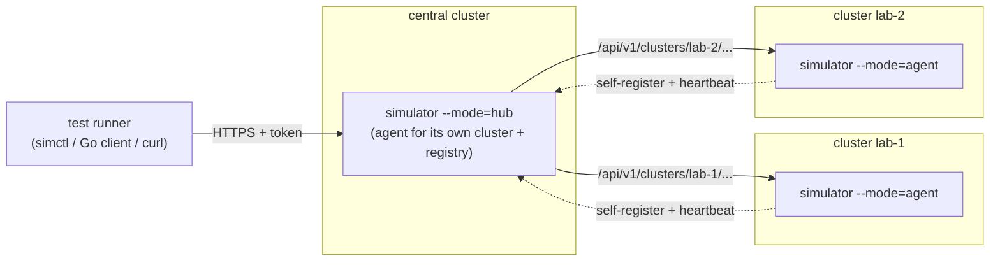

# Simulations

Failure and recovery simulations to run **during tests** against the test
environments in [`../environments`](../environments). There is one directory
per environment; each one documents which simulations it has and how to run
them.

| Environment | Simulations | Docs |
|---|---|---|
| `nvidia-sim` | 23 types: GPU faults through Mokka (Xid, lost GPU, ECC, overheat, throttling, memory pressure, NVLink, fabric…), Dynamo faults (worker/frontend kill and partition, operator restart), Kubernetes faults (pod kill, network isolation, node cordon) | [nvidia-sim/README.md](nvidia-sim/README.md) · [catalog](nvidia-sim/CATALOG.md) |
| `runai-sim` | Run:ai-style: virtual GPU node failure (`kwok-node-down`), fake GPU utilization (`fgo-gpu-utilization`), plus pod kill / cordon / isolation on the virtual fleet | [runai-sim/README.md](runai-sim/README.md) |
| `qa` | none yet: the generic Kubernetes types can be used once QA has workloads | [qa/README.md](qa/README.md) |

## How it works

The simulations are run by a Kubernetes **controller** with a `Simulation`
CRD and an HTTP **API**, so test runners can inject and recover faults from
anywhere:

- **Agent**: runs in a cluster, reconciles `Simulation` objects (inject → hold
  → recover → verify) and serves the API for that cluster.
- **Hub**: an agent that also keeps a registry of remote agents
  (`SimulationCluster`), routes `/api/v1/clusters/<name>/…` to them, and has
  fleet-wide calls (list everything, emergency recover-all).
- A test runner can talk to an agent directly, or to the hub with a cluster
  name. It can also simply `kubectl apply` a `Simulation`.

Details: [nvidia-sim/docs/architecture.md](nvidia-sim/docs/architecture.md),
API: [nvidia-sim/docs/api.md](nvidia-sim/docs/api.md).

## Adding simulations for an environment

1. Create `simulations/<env>/README.md` listing what can be simulated and why.
2. If the env needs new fault types, add an `Injector` in
   `nvidia-sim/internal/inject` (see `k8s.go` for small examples) and
   register it in `All()`, or create a `simulations/<env>/` Go module of its
   own based on this one if the env is unrelated.
3. Run `make catalog` so the catalog doc matches the code.
