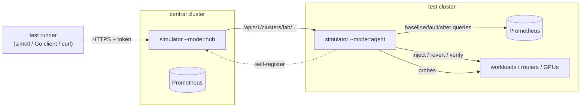

# Simulations

Failure and recovery simulations to run **during tests** against the
environments in [`../environments`](../environments), with measurements
before, during and after each fault. There's one directory per environment,
saying which simulations make sense there and how to run them. All of them run
on one controller.

| Directory | What |
|---|---|
| [controller/](controller/README.md) | The Go controller: `Simulation` CRD, HTTP API, `simctl`, Go client, hub + remote agents. [Catalog of all 60 types](controller/CATALOG.md) |
| [faults/](faults/README.md) | Generic faults for any workload: latency, jitter, packet loss, corruption, reordering, bandwidth, dependency / DNS / service outages, CPU / memory stress, container crashes |
| [controller/docs/observability.md](controller/docs/observability.md) | **How to monitor and extract metrics**: baseline / fault / recovery / after windows, Prometheus profiles, probes, reports, CSV export, Grafana |

| Environment | Simulations | Guide |
|---|---|---|
| `nvidia-sim` | GPU faults through Mokka (Xid, lost GPU, ECC, thermal, power, NVLink, fabric…), Dynamo worker/frontend/operator faults | [nvidia-sim/](nvidia-sim/README.md) |
| `nvidia-dynamo-disagg` | prefill/decode kills (request migration), KV-router and prefill/decode network impairment, GPU faults on workers | [nvidia-dynamo-disagg/](nvidia-dynamo-disagg/README.md) |
| `nvidia-triton-cpu` | inference server under latency/jitter/loss, CPU/memory pressure, replica loss vs PDB/HPA, crash restarts | [nvidia-triton-cpu/](nvidia-triton-cpu/README.md) |
| `nvidia-dra-sim` | GPU faults on DRA-allocated GPUs, claim holder and DRA plugin kills | [nvidia-dra-sim/](nvidia-dra-sim/README.md) |
| `nvidia-nvsentinel` | GPU faults NVSentinel must detect, quarantine and drain for (Xid 79, DBE, 142 °C, lost GPU) | [nvidia-nvsentinel/](nvidia-nvsentinel/README.md) |
| `nvidia-vllm` | vLLM pod kill / slowdown behind the InferencePool, EPP loss, Envoy load; Dynamo worker/frontend faults | [nvidia-vllm/](nvidia-vllm/README.md) |
| `dc-ot-sim` | `ot-*`: utility outage, generator fail-to-start, UPS/PDU faults, CDU pump failure and leaks, CRAH/chiller trips, heatwave, IT surge, stuck/drifting sensors, comms loss | [dc-ot-sim/](dc-ot-sim/README.md) |
| `runai-sim` | virtual GPU node failure, fake GPU utilization, cordon/kill on the virtual fleet | [runai-sim/](runai-sim/README.md) |
| `network-kne` | router link down / flap / latency / loss, router crash, measured with ping probes and gNMI counters | [network-kne/](network-kne/README.md) |
| `qa` | the generic faults once QA has workloads | [qa/](qa/README.md) |
| `observability` | none: it is what measures the others | [../environments/observability](../environments/observability/README.md) |

Locally: `make simulator`, then `make sim-suite ENV=<env>` runs that
environment's `suite.txt` and saves reports (see [docs/local.md](../docs/local.md)).

## How it works

1. A runner creates a `Simulation` (API, `simctl`, or `kubectl apply`), optionally with `observe`.
2. The controller measures a **baseline**, injects the fault, holds it, reverts it, and **verifies** recovery.
3. It measures the **after** window and stores a report: per-window stats and change against the baseline, plus `timeToRecover`.
4. The runner reads the report (`simctl report`) and raw data (`simctl metrics > run.csv`), and asserts on them.

## Adding simulations for an environment

1. Write `simulations/<env>/README.md`: what to simulate there, which targets,
   which metrics profile and probe show the effect.
2. If a new kind of fault is needed, add an `Injector` in
   `controller/internal/inject` and register it in `All()`. If it needs new
   metrics, add a profile in `controller/internal/observe/profiles.go` or the
   profiles ConfigMap.
3. Run `make -C simulations/controller all` so the catalog and generated files match.
