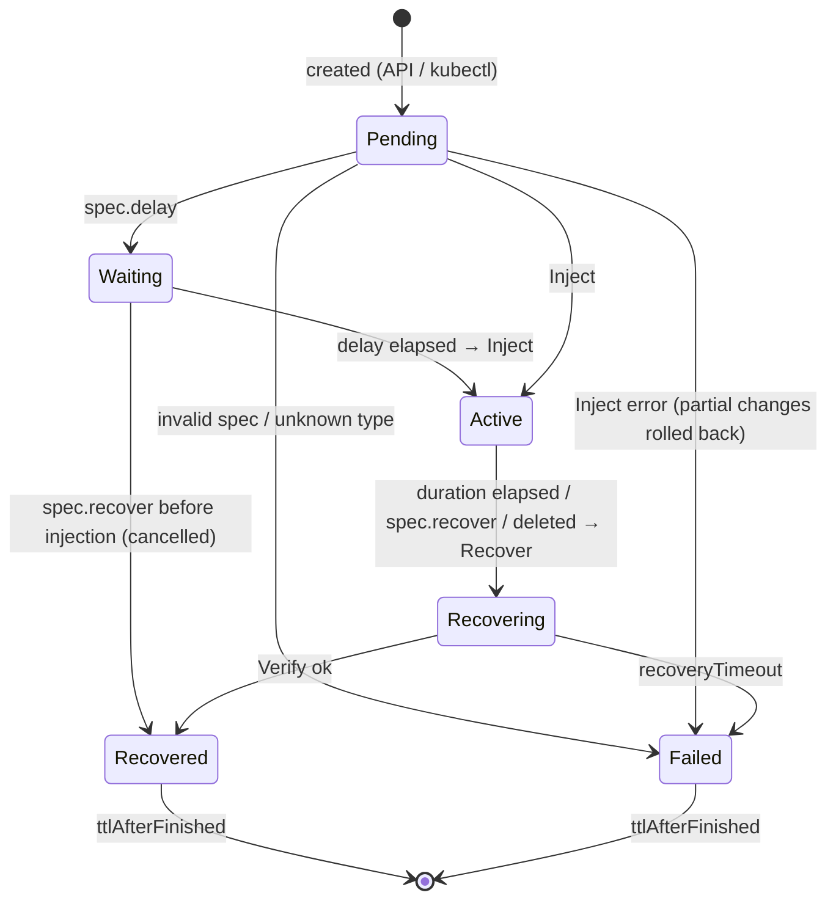
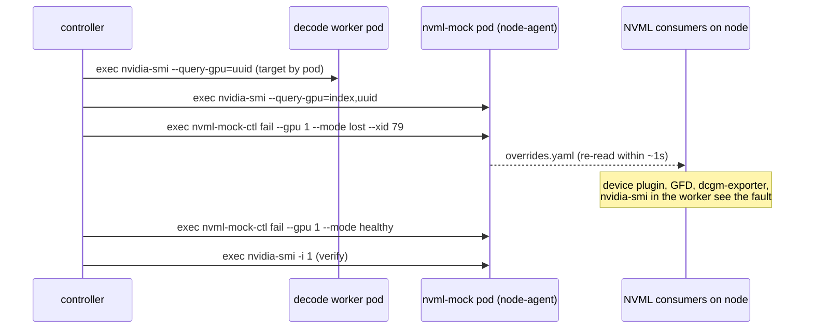
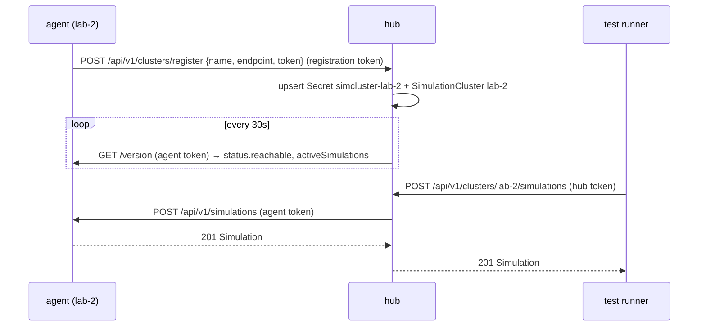

# Architecture

## Components

| Component | Where | Role |
|---|---|---|
| `Simulation` CRD (namespaced) | every cluster with the controller | One fault: type, target, params, timing. Status records exactly what was changed. |
| `SimulationCluster` CRD (cluster-scoped) | hub cluster | A remote agent: endpoint, token Secret, TLS. Status: reachable, version, active count. |
| `simulator --mode=agent` | each test cluster | Reconciles Simulations, serves the API. |
| `simulator --mode=hub` | central cluster | Agent for its own cluster plus the registry, router and fleet API. |
| `simctl`, `pkg/client` | test runners | CLI / Go client for the API. |

The controller is one binary. The mode only switches on extra API routes and
the hub's background prober. In agent mode, `--hub-url` adds the
self-registration heartbeat.

## Simulation lifecycle



Each type implements:

```go
type Injector interface {
    Entry() catalog.Entry                       // catalog / docs
    Validate(sim) error                         // before anything changes
    Inject(ctx, env, sim) (Result, error)       // apply; Result → status.targets/data
    Recover(ctx, env, sim) (string, error)      // undo exactly status.targets
    Verify(ctx, env, sim) (done, msg, error)    // polled until healthy
}
```

Design points:

- **Recorded targets.** The injection's concrete targets (node + GPU index, pod
  UIDs, NetworkPolicy name, nodes it cordoned) go into `status.targets`.
  Recovery acts on those, not on a re-evaluated selector. Then a pod that
  appeared later is never touched, and a node someone else cordoned is never
  uncordoned.
- **Verified recovery.** Undoing a fault isn't the end of it. `Verify` checks
  the outcome: nvidia-smi answers for the GPU, the same number of pods are
  Ready, the NetworkPolicy is gone. `timeToRecover` measures fault →
  verified healthy, which is often the number a resilience test wants.
- **Finalizer.** `sim.testenv.onit.ai/recover` makes deletion revert first. If
  recovery fails on delete, the error goes out as an event and the finalizer
  is still removed, so the namespace can't get stuck.
- **Serialised.** `MaxConcurrentReconciles: 1`: Mokka's overrides file is
  read-modify-written per node.

## GPU faults through Mokka



The controller needs `pods/exec` on the Mokka namespace and on the target pods
(cluster-wide in the generated ClusterRole).

## Hub and agents



- **Connectivity:** the hub calls agents, so agents need a hub-reachable
  endpoint (NodePort/Ingress/LoadBalancer). Agents only need outbound access
  to the hub, and only for self-registration. A static `SimulationCluster`
  needs none.
- **Three tokens:** the hub API token (runners → hub), the registration token
  (agents → hub register only), and each agent's API token (hub → agent,
  stored by the hub as a Secret). The hub reads Secrets uncached and only in
  its own namespace.
- **Local cluster:** the hub's own cluster appears in `/api/v1/clusters` as
  `local: true`. Routing to it is served in-process.
- **Manual vs registered:** registration only overwrites `SimulationCluster`s
  it created (label `sim.testenv.onit.ai/registered=true`).
- **Fleet calls** run in parallel and return a result or an error per cluster,
  so one dead cluster doesn't hide the others.

## Why a controller plus an API

| Need | How it is met |
|---|---|
| Faults survive runner crashes and are always reverted | State lives in the CR; durations and recovery run in-cluster; finalizer |
| Runners anywhere (CI, laptops, other clusters) | HTTP API + token, `simctl`, Go client |
| GitOps / kubectl users | Plain CRs work without the API |
| Many clusters | Hub registry + routing + fleet calls; agents unchanged |
| Auditable | Kubernetes events, `kubectl get sims`, status targets/data, labels per test run |
